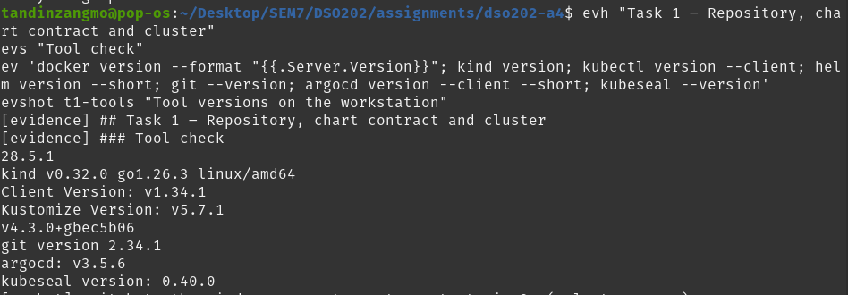
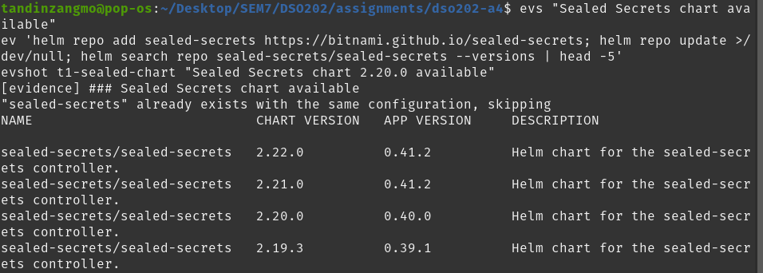

<!--
docs/evidence.md
Assignment: DSO202 A4 (GitOps delivery of the Task Tracker with Argo CD)
Descriptor: 4.1-4.4
Purpose: command output for every task, one section per task, in task order.
Credentials and the sealing key never appear here: Secret keys are shown,
values are not.
-->
# DSO202 A4 – Evidence

Each block shows the command after `$` and its real output. Screenshots are
in `docs/screenshots/` and are linked where a task asks for one.
## Task 1 – Repository, chart contract and cluster


### Tool check

```console
$ docker version --format "{{.Server.Version}}"; kind version; kubectl version --client; helm version --short; git --version; argocd version --client --short; kubeseal --version
28.5.1
kind v0.32.0 go1.26.3 linux/amd64
Client Version: v1.34.1
Kustomize Version: v5.7.1
v4.3.0+gbec5b06
git version 2.34.1
argocd: v3.5.6
kubeseal version: 0.40.0
```




### Sealed Secrets chart available

```console
$ helm repo add sealed-secrets https://bitnami.github.io/sealed-secrets; helm repo update >/dev/null; helm search repo sealed-secrets/sealed-secrets --versions | head -5
"sealed-secrets" already exists with the same configuration, skipping
NAME                         	CHART VERSION	APP VERSION	DESCRIPTION                                  
sealed-secrets/sealed-secrets	2.22.0       	0.41.2     	Helm chart for the sealed-secrets controller.
sealed-secrets/sealed-secrets	2.21.0       	0.41.2     	Helm chart for the sealed-secrets controller.
sealed-secrets/sealed-secrets	2.20.0       	0.40.0     	Helm chart for the sealed-secrets controller.
sealed-secrets/sealed-secrets	2.19.3       	0.39.1     	Helm chart for the sealed-secrets controller.
```




